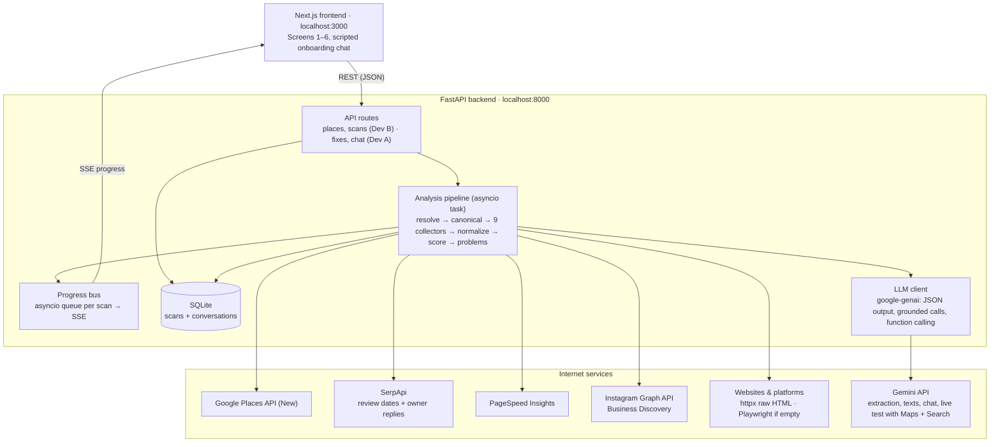

# [App name] — Architecture (hackathon v1)

*Final version · 14 November 2026*

A Next.js frontend and a Python (FastAPI) backend, both running on one laptop. The backend runs the analysis as a background job, streams progress to the loading screen and saves each scan as JSON in SQLite. Built by 2 devs in under 24 hours, with a recorded demo scan as a safety net.

Companion documents:

| Path | What it holds |
| --- | --- |
| [contract.md](contract.md) | Every endpoint, request and response shape. Frozen at gate 1. |
| [data-collection-algorithm.md](data-collection-algorithm.md) | Every check, its data source, points, weights and the pipeline |
| [prompts/dev-a-frontend.md](prompts/dev-a-frontend.md) | The Claude Code prompt for Dev A |
| [prompts/dev-b-backend.md](prompts/dev-b-backend.md) | The Claude Code prompt for Dev B |
| [../design/](../design/) | 24 artboards (`*.dc.html`), `canvas.json`, `README.md` with tokens |
| [../CLAUDE.md](../CLAUDE.md) | Ground rules and file ownership every Claude Code session loads |

---

## Team split

| | Dev A · screens + fix & assistant backend | Dev B · data pipeline |
| --- | --- | --- |
| Builds | All of `frontend/`; the backend for fix texts, the info page, the developer export and the assistant chat | The rest of `backend/`: API skeleton, places, scans, progress stream, all collectors, scoring, problem cards, demo mode |
| Accounts | Two Gemini keys, shared with Dev B: `GEMINI_API_KEY` from a free-tier AI Studio project (no billing) and `GEMINI_GROUNDED_API_KEY` from a billed project, used only for grounded calls | Google Cloud project (Places API (New), PageSpeed Insights API), SerpApi, Meta app for Instagram |
| Owns | `frontend/**`, root `package.json`, `backend/app/api/fixes.py`, `backend/app/api/chat.py`, `backend/app/fixes/**`, `backend/app/assistant/**`, `backend/app/llm/prompts/fix_*`, `backend/app/llm/prompts/assistant_*` | Everything else in `backend/**`, including `pyproject.toml`, `models.py`, `db.py`, `llm/client.py`, `services/resolution.py`, `fixtures/` |
| Hands over | Gemini keys (hour 0); root `npm run dev` (hour 1); `api/fixes.py`, `api/chat.py`, `fixes/`, `assistant/` written against the contract (before gate 1), working end to end once Dev B's skeleton lands | Skeleton serving the fixture, with `llm/client.py`, `services/resolution.py`, `db.py`, `cache.py` usable (hour 2, gate 1); real `resolve` (hour 5); a real report (hour 14, gate 2) |

Rules for working on one repo in parallel:

- Both push to `main` in small commits. Run `git pull --rebase` before starting each task and before every push; the other dev pushes often. Never force-push.
- Never edit a file the other dev owns. If you need a change there, ask; for the contract, follow the change rule in [contract.md](contract.md).
- Dev A writes `api/fixes.py` and `api/chat.py` against the contract before gate 1; Dev B doesn't create stubs for them, only registers their routers in `main.py`.
- Nothing may bill. Use free tiers only, check a service's free quota before calling it, and cache every response. The one exception is `GEMINI_GROUNDED_API_KEY`: grounded calls (live test, mentions) bill their tokens, so make them only for the real scans needed for gate 2 and the demo recording.
- Dev A's backend code imports only `app.models`, `app.db`, `app.llm.client`, `app.services.resolution` and `app.cache`. A new Python dependency goes through Dev B (`pyproject.toml`).
- Frozen after this commit, changed only when both agree: `docs/architecture.md`, `docs/data-collection-algorithm.md`, `CLAUDE.md`, `README.md`, `.gitignore`.

---

## At a glance



The browser only talks to FastAPI: REST for data, SSE for the loading steps.

---

## Tech stack

| Layer | Choice | Why |
| --- | --- | --- |
| Frontend | Next.js (latest, App Router) + React + TypeScript, npm | Fast routing per screen |
| UI | Tailwind CSS v4 (tokens in `globals.css` `@theme`), shadcn/ui, Framer Motion, custom SVG score ring | Rounded cards, sheets and ring animations come cheap |
| Font | Plus Jakarta Sans via `next/font/google`, subsets `latin` + `latin-ext` | Covers ă â î ș ț |
| Backend | Python 3.12 + FastAPI + Uvicorn, managed with `uv` | Async by default; good SDKs for Gemini and HTML parsing |
| Job runner | `asyncio` background task inside FastAPI | One laptop, one scan at a time |
| Progress | Server-Sent Events (`sse-starlette`) | One-way stream; simpler than WebSockets |
| Storage | SQLite via SQLModel, report stored as JSON | Zero setup |
| LLM | Gemini API via `google-genai`, structured JSON output | Maps and Search grounding built in |
| Data APIs | Places API (New), SerpApi, PageSpeed Insights, Instagram Graph API, all over `httpx` | See [data-collection-algorithm.md §8](data-collection-algorithm.md) |
| Fetching | `httpx`, Playwright for Python (fallback render), `selectolax`, `urllib.robotparser` | Raw HTML is what non-Google AI crawlers see |
| Matching | `phonenumbers`, `rapidfuzz` | Phone and name/address comparison |
| Shared types | FastAPI OpenAPI schema → `openapi-typescript` | Frontend types stay in sync |
| Run | Root `package.json`: `npm run dev` runs both servers with `concurrently` | Works on Windows and macOS |

---

## Design

The UI follows the Claude Design canvas exported to `design/` (see [design/README.md](../design/README.md)): 24 artboards, desktop (1440 px) and mobile (390 px). It is the source of truth for layout, copy and look. Read the `*.dc.html` files as specs (custom tags explained in the design README); rebuild them in React + Tailwind. Light mode only.

| Screen | Desktop artboard | Mobile artboard | Route |
| --- | --- | --- | --- |
| 1 · Configurare | `Main` | `MConfigurare` | `/start` |
| Analysis in progress | `Analiza` | `MAnaliza` | `/scan/[id]/loading` |
| Link can't be read | `Eroare` | — | error state on `/start` |
| 2 · Panou principal | `Panou` | `MPanou` | `/scan/[id]` |
| 3 · Capitol | `Capitol`, `CapitolGol` (all solved) | `MCapitol` | `/scan/[id]/[chapter]` |
| 4 · Rezolvare | `Rezolva` (Instagram text), `FisaInfo` (info page) | `MRezolva`, `MFisaInfo` | side panel / bottom sheet on the chapter route, `?fix=<check_id>` |
| 5 · Vizibilitate în Gemini | `Gemini` | `MGemini` | `/scan/[id]/gemini` |
| 6 · Conversații | `Conversatii`, `Chat` | `MConversatii`, `MChat` | `/scan/[id]/conversatii`, `/scan/[id]/conversatii/[cid]` |
| Shared | `ScoreRing`, `Sidebar`, `TabBar`, `Sistem` (tokens) | — | `frontend/src/components/` |

Desktop (≥ 1024 px) shows the sidebar; below that, the bottom tab bar. Every screen is built responsive against both its artboards at the same time.

### Where the build differs from the design

The design's mock numbers (Boema: overall 42, Gemini 2/12, chapters 65/50/35/50/35/25/55/20) are the hour-1 fixture. Problem titles and points come from the check catalog, so individual problem points won't always match the artboards.

| Design | Build |
| --- | --- |
| „Ultima analiză: azi · următoarea, automat, peste 7 zile”, „Verificăm din nou în fiecare săptămână” | No scheduler: „Ultima analiză: azi” only; drop the weekly sentence |
| „Analizează din nou” | Starts a new scan with the same inputs (`POST /rescan`), goes to its loading screen |
| „Am citit 38 de recenzii” | „Am găsit 38 de recenzii” (from the SSE `detail_ro`) |
| Business switcher, „Datele afacerii”, „Ajutor” | Shown but not interactive |
| Gemini screen without sources | Each prompt shows its sources under the result, with „Surse: Google Maps” attribution (required by Maps grounding) |
| Photo counts 64/41/28 | „10+” when the API cap is hit |
| Only the Instagram and info-page panels are designed | A generic panel (steps + deep link + „Am rezolvat”) and a dev-export panel in the same style |
| No self-report questions in the onboarding | Quick-reply chips inside step 5 (after the place is picked: profile claimed? description? last Google post?) and step 6 (last social post?). Still 7 steps. |
| `[Nume aplicație]` | `APP_NAME` in `frontend/src/config.ts` until the name is chosen |

Navigation: desktop sidebar (business card, Panou principal, Vizibilitate în Gemini with „2/12”, Conversații, the 8 chapters with open-problem counts and the „Începe de aici” marker); mobile tab bar (Acasă, Gemini, Capitole, Asistent).

---

## API contract

Fully specified in [contract.md](contract.md). Summary:

| Method | Path | Screen | Owner |
| --- | --- | --- | --- |
| `POST` | `/api/places/search` | 1 | B |
| `POST` | `/api/places/resolve-link` | 1, `Eroare` | B |
| `POST` | `/api/scans` | 1 | B |
| `GET` | `/api/scans/{id}/events` (SSE) | loading | B |
| `GET` | `/api/scans/{id}` | 2, 3, 5 | B |
| `POST` | `/api/scans/{id}/rescan` | 2 | B |
| `POST` | `/api/scans/{id}/problems/{check_id}/resolve` | 4 | B |
| `POST` | `/api/scans/{id}/gemini-test` | 5 | B |
| `POST` | `/api/scans/{id}/fixes/{check_id}/generate` | 4 | A |
| `GET` | `/api/scans/{id}/info-page` | 4 | A |
| `GET` | `/api/scans/{id}/dev-export` | 4 | A |
| `GET` / `POST` | `/api/scans/{id}/conversations` | 6 | A |
| `GET` | `/api/conversations/{cid}` | 6 | A |
| `POST` | `/api/conversations/{cid}/messages` | 6 | A |
| `POST` | `/api/conversations/{cid}/actions/{action_id}` | 6 | A |

---

## Frontend (Dev A)

| Route | Screen | Talks to |
| --- | --- | --- |
| `/` | Redirects to `/start` | — |
| `/start` | 1 — scripted chat onboarding + business card | `places/search`, `places/resolve-link`, `POST scans`, `POST conversations` (onboarding transcript) |
| `/scan/[id]/loading` | Loading steps | SSE `events`; „Vezi rezultatele” on mobile, auto-redirect on desktop when complete |
| `/scan/[id]` | 2 — dashboard | `GET scans/{id}`, `rescan` |
| `/scan/[id]/[chapter]` | 3 — chapter; 4 opens as a side panel / bottom sheet via `?fix=` | `resolve`, `generate`, `info-page`, `dev-export` |
| `/scan/[id]/gemini` | 5 — Gemini visibility | `gemini-test` |
| `/scan/[id]/conversatii` | 6 — conversation list | `GET` / `POST conversations` |
| `/scan/[id]/conversatii/[cid]` | 6 — chat, chapter score card beside it | `GET conversation`, `messages`, `actions` |

Key components: `ScoreRing`, `Sidebar`, `TabBar`, `ChapterCard`, `ProblemCard`, `FixPanel` (generic, Instagram text, info page, dev export), `ChatMessage` + `QuickReplyChips`, `BusinessCardSummary`, `ProgressSteps`, `ActionCard`, `Toast`.

- **Data:** plain `fetch` to `NEXT_PUBLIC_API_URL`; types from `npm run gen:api`.
- **„Am rezolvat”:** update the score in local state first so the ring animates at once, then call `resolve` and replace local state with `ScoreUpdate.report`.
- **Onboarding chat** is scripted in the browser: fixed questions, no LLM.

---

## Backend

One FastAPI process, one Uvicorn worker, no `--reload` while a scan runs (the progress queue lives in memory).

```text
backend/
  pyproject.toml, uv.lock, .env.example                                  B
  app/
    main.py              FastAPI app, CORS for localhost:3000, routers   B
    config.py            settings from .env                               B
    models.py            Report, ScanInputs, ScoreUpdate, … (contract)    B
    db.py                SQLite engine, scans + conversations tables      B
    cache.py             disk cache keyed by request hash                 B
    jobs.py              start_scan(), progress bus → SSE                 B
    api/places.py, api/scans.py                                           B
    api/fixes.py, api/chat.py                                             A
    services/resolution.py  mark/unmark resolved, load report/inputs/facts B
    pipeline/
      resolve.py, canonical.py, normalize.py, scoring.py, problems.py     B
      collectors/        google_profile, reviews, website, listings, mentions,
                         social, training_probe, live_test, competitors   B
    llm/
      client.py          json_call, text_call, grounded_call, get_client  B
      prompts/           pipeline prompts                                 B
                         fix_*.md, assistant_*.md                         A
    fixes/               schemas.py, generate.py, info_page.py, dev_export.py   A
    assistant/           schemas.py, agent.py (function calling), store.py      A
  fixtures/boema_report.json                                              B
  cache/                 fetched pages and LLM answers (git-ignored)
```

**How a scan runs:**

1. `POST /api/scans` saves a row with status `running` and starts `asyncio.create_task(run_pipeline(scan_id))`.
2. The pipeline pushes `ScanEvent`s into that scan's queue; `GET /events` streams them (and replays them for late subscribers).
3. The live test starts right after the canonical profile; the other collectors run with `asyncio.gather`, each with its own timeout ([data-collection-algorithm.md §3](data-collection-algorithm.md)). A failed or slow collector marks its checks `unknown`.
4. A semaphore caps concurrent Gemini calls at 6; Playwright launches lazily, only for a page whose raw HTML is empty.
5. The report is saved as JSON in SQLite and a `complete` event closes the stream.

---

## LLM roles

The LLM reads and writes; code decides. Scores never come from the LLM.

| Step | Who does it | What the LLM does |
| --- | --- | --- |
| Onboarding chat | Scripted flow in the frontend | — |
| Finding problems | Code checks (Dev B) | Reads messy pages into JSON, judges category and Instagram bio, classifies mentions |
| Scoring and ranking | Code only (`scoring.py`) | — |
| Live test | Code + Gemini with Maps + Search grounding | Answers the customer's question; nothing else is sent |
| Fix texts, info page, dev export | Dev A, `fixes/` | Writes the custom texts from the canonical profile and website facts |
| Assistant chat | Dev A, `assistant/` | Proposes actions via function calling; the owner confirms or undoes |

Assistant functions (Screen 6):

- `get_report()` — current scores and open problems.
- `propose_mark_resolved(check_ids)` — returns a pending `ProposedAction` the UI shows as „Da, marchează-le / Doar descrierea / Nu încă”. Nothing changes until the owner confirms through `POST /actions/{id}`; „Anulează” reverts it.
- `generate_fix_text(check_id, tone)` — same generator as the fix panel.
- `what_next()` — the open problem with the highest impact.

Model tiers, set in `backend/.env` (all marked stable on Google's models page, 14 November 2026; combining Maps and Search grounding needs Gemini 3.5 Flash or later):

- `GEMINI_MODEL_FAST=gemini-3.5-flash-lite` — extraction, classification, judging, prompt generation.
- `GEMINI_MODEL_SMART=gemini-3.8-flash` — fix texts, info page, assistant chat.
- `GEMINI_MODEL_LIVE=gemini-3.8-flash` — the live test and mention searches with grounding, called with `GEMINI_GROUNDED_API_KEY`.

Two open points for Dev B to verify before building the live test: Google's Maps grounding page says it "currently only supports English language prompts and responses", and its examples use the Interactions API (`client.interactions.create`) rather than `generateContent`.

---

## Data and storage

| Store | Holds | Notes |
| --- | --- | --- |
| `scans` table | `id`, `created_at`, `status`, `inputs` (JSON), `internal` (JSON: canonical, website facts, check results), `report` (JSON), `error` | Resolving recomputes scores from `internal` and rewrites `report` |
| `conversations` table | `id`, `scan_id`, `kind`, `title`, `chapter_id`, `messages` (JSON), `pending_actions` (JSON), `created_at`, `updated_at` | Screen 6 |
| `cache/` | fetched HTML, API responses, LLM answers, keyed by request hash | Saves money while developing; lets a scan replay offline |
| `fixtures/boema_report.json` | Mock report (hour 1), replaced by a recorded real scan (hour 20) | Demo mode |

Place IDs can be stored freely; check the Google Maps Platform terms before keeping other Places content beyond the hackathon.

---

## External services and keys

Set them up before the hackathon starts; billing and key restrictions are the usual time sinks.

| Service | Set up by | Used for | Watch out for |
| --- | --- | --- | --- |
| Gemini API (free tier) | Dev A | `GEMINI_API_KEY`: extraction, texts, chat, probe | Free tier: no grounding, lower rate limits |
| Gemini API (billed) | Dev A | `GEMINI_GROUNDED_API_KEY`: live test, mentions | Grounding needs the paid tier: 5,000 free grounded requests/month, but tokens are billed. Live test = 36 grounded calls per scan |
| Google Places API (New) | Dev B | Search, Place Details, Nearby Search | Key restricted to Places API (New) + PageSpeed Insights API; max 5 reviews, 10 photos |
| PageSpeed Insights API | Dev B | T07 mobile speed | Same Google Cloud project; one run takes 15–30 s |
| SerpApi | Dev B | Review dates and owner replies | Free plan ~250 searches/month: cache every response |
| Instagram Graph API | Dev B | Bio, website, posts via Business Discovery | Needs a Meta app, your own Instagram professional account linked to a Facebook Page, and a long-lived token; only works for business/creator accounts. Do it the night before. |
| Playwright for Python | Dev B | Fallback render | `uv run playwright install chromium` |

`backend/.env` is shared by both devs' backend code and never committed. `backend/.env.example` holds the same names, with values only for non-secret settings. Copy it to `backend/.env` and paste the keys (shared privately):

```text
GEMINI_API_KEY=
GEMINI_GROUNDED_API_KEY=
GEMINI_MODEL_FAST=gemini-3.5-flash-lite
GEMINI_MODEL_SMART=gemini-3.8-flash
GEMINI_MODEL_LIVE=gemini-3.8-flash
PLACES_API_KEY=
PAGESPEED_API_KEY=
SERPAPI_API_KEY=
META_ACCESS_TOKEN=
META_IG_USER_ID=
DEMO_MODE=off
DEMO_PLACE_ID=
FRONTEND_ORIGIN=http://localhost:3000
```

`frontend/.env.local`: `NEXT_PUBLIC_API_URL=http://localhost:8000`.

---

## 24-hour build plan

| Hours | Dev A · screens + fixes & assistant backend | Dev B · data pipeline |
| --- | --- | --- |
| 0–1 | Gemini keys to Dev B; scaffold `frontend/`, root `npm run dev`, tokens, font | Accounts; FastAPI skeleton, `models.py` per contract, `db.py`, fixture |
| 1–2 | `ScoreRing`, `Sidebar`, `TabBar`, `Toast`, app shell (static) | Stub routes for every endpoint (incl. fixes/chat) serving the fixture; SSE replay |
| **2** | **Gate 1:** generate API types from the stub server | **Gate 1:** push the skeleton |
| 2–5 | Screen 1 onboarding (search, link, `Eroare`, self-report chips, business card) | Places search/resolve, canonical, normalize, `llm/client.py`, Google profile collector, `scoring.py`, `problems.py`, `resolution.py` + `resolve` |
| 5–6 | Loading screen with SSE | Real `jobs.py` pipeline with progress |
| 6–9 | Dashboard, chapter page, empty state, generic fix panel + „Am rezolvat” | Reviews (Places + SerpApi), Nearby competitors |
| 9–12 | `fixes/` backend (generate, info page, dev export); Instagram text + info page + dev export panels | Website collector (httpx, Playwright fallback, robots, sitemap, JSON-LD, PageSpeed, L2 extraction) |
| 12–14 | Gemini screen (sources + attribution, „Testează din nou”), „Analizează din nou” | Live test, competitors, `gemini-test`, `rescan` |
| **14** | **Gate 2:** a real scan renders on every screen | **Gate 2:** `POST /api/scans` for a real café completes in under 90 s |
| 14–18 | `assistant/` backend (conversations, function calling, actions) + Conversații and Chat screens | Training probe, mentions, social (website links, Meta, Facebook), listings |
| 18–20 | States (unknown, errors, empty), mobile pass at 390 px, animations | Demo mode, retries and backoff, record the demo scan |
| **20** | **Gate 3:** feature freeze | **Gate 3:** demo mode works with Wi-Fi off |
| 20–22 | Bugs, demo script | Bugs, re-record the fixture if needed |
| 22–24 | Rehearse demo + buffer | Rehearse demo + buffer |

**Gates:** hour 2 contract frozen · hour 14 first real scan end to end · hour 20 feature freeze. If time runs short, cut polish first; gate 2 is the one that matters.

**Fallbacks:** if the assistant backend isn't working at hour 17, Dev A replaces it with a scripted demo conversation for the demo café. If a collector isn't ready by hour 18, its checks stay `unknown`.

---

## Demo safety

- **Demo mode:** with `DEMO_MODE=fixture`, a scan whose `place_id` equals `DEMO_PLACE_ID` returns `fixtures/boema_report.json` and still plays the loading steps over about 8 s.
- **Record a real scan the evening before** and save it as the fixture: real data, replayed.
- **Live scan as a bonus:** offer to scan a judge's business; if it errors or stalls, switch to the fixture without comment.
- **Cache everything** fetched during development, so a repeat scan works offline.
- **One command starts both servers:** `npm run dev` at the repo root.
- **Laptop:** disable sleep, keep a phone hotspot ready, open the dashboard tab before you present.

Still to pick before recording: the real demo café (needs a website and a business Instagram account) and the app name.

---

## Scope cuts

- No accounts, login or deployment; everything on localhost.
- Gemini only; no ChatGPT engine.
- No Tripadvisor data, Bing Places, Apple Maps or Romanian directories.
- Reviews: Google (Places + SerpApi) only.
- Social: Facebook link check, Instagram via Business Discovery, TikTok link only; posts on other platforms are self-reported.
- Mentions: titles and domains only, no page reading.
- Listings: only links the owner gave or the website shows.
- The LLM writes texts for `generate` problems (demo: Instagram bio, Google description), the info page and the developer export; other problems show template steps.
- Assistant chat: only the four functions above.
- „Testează din nou” reruns only the Gemini test.
- Romanian prompts and UI only, strings hard-coded.
- No dark mode.

---

## Sources

- [Places API (New): Place resource](https://developers.google.com/maps/documentation/places/web-service/reference/rest/v1/places)
- [Gemini API: Grounding with Google Maps](https://ai.google.dev/gemini-api/docs/maps-grounding)
- [Firebase AI Logic: Grounding with Google Maps](https://firebase.google.com/docs/ai-logic/grounding-google-maps)
- [SerpApi: Google Maps Reviews API](https://serpapi.com/google-maps-reviews-api)
- [Instagram Platform: Business Discovery](https://developers.facebook.com/docs/instagram-platform/instagram-api-with-facebook-login/business-discovery)
- [PageSpeed Insights API](https://developers.google.com/speed/docs/insights/v5/get-started)
- [Vercel: The rise of the AI crawler](https://examples.vercel.com/blog/the-rise-of-the-ai-crawler)
