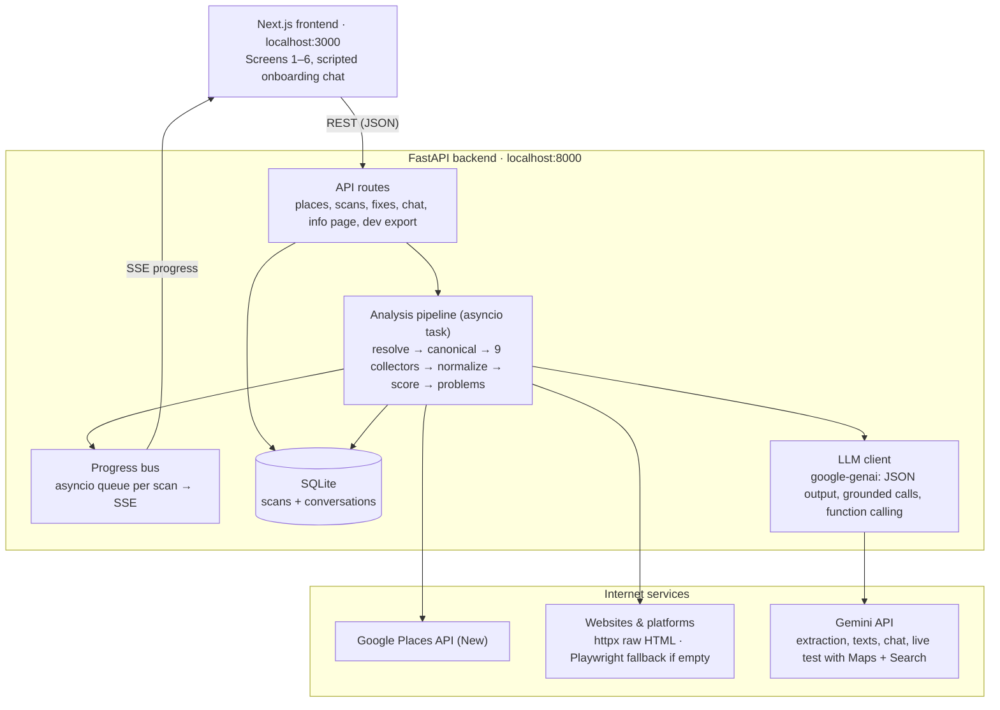

# [App name] — Architecture (hackathon v1)

*Final version · 14 November 2026*

A Next.js frontend and a Python (FastAPI) backend, both running on one laptop. The backend runs the analysis as a background job, streams progress to the loading screen and saves each scan as JSON in SQLite. Built by 2 devs in under 24 hours, with a precomputed demo scan as a safety net.

---

## How to build this with Claude Code

Put these in the repo before the first prompt, so every session reads the same sources:

| Path | What it holds | Comes from |
| --- | --- | --- |
| `docs/architecture.md` | This plan | This file |
| `docs/data-collection-algorithm.md` | Every check, its points and the weights | `data-collection-algorithm.md` |
| `design/` | 24 artboards, `canvas.json`, a README with tokens | `design.zip` |
| `backend/.env` | `GEMINI_API_KEY`, `PLACES_API_KEY`, `DEMO_MODE` | Your keys |

- **One Claude Code session per dev:** Dev A in `frontend/`, Dev B in `backend/`. Both start from the API contract.
- **Follow the build plan order** and check each gate before moving on:
    1. **Hour 1, contract frozen:** `fixtures/boema_report.json` validates against the `Report` model, and the frontend types are generated from the OpenAPI schema.
    2. **Hour 14, first real scan:** `POST /api/scans` for a real café returns a complete report in under 90 s, and the dashboard renders it.
    3. **Hour 20, feature freeze:** demo mode replays the recorded scan with Wi-Fi off, and every artboard in `design/` has a working route or state.
- **Ground rules to give Claude Code:**
    - Copy Romanian text and styles from `design/*.dc.html`, tokens from `design/README.md`; light mode only.
    - Scores come only from code (`scoring.py`); the LLM never sets a score.
    - Live-test prompts carry no system prompt and no business context.
    - Fetch websites with `httpx`; start Playwright only for pages that come back empty.

---

## At a glance



The browser only talks to FastAPI: REST for data, SSE for the loading ticks. Everything that reaches the internet goes through the pipeline and the LLM client.

---

## Tech stack

TypeScript on the front, Python on the back. Nothing to deploy: Node, Python and a Chromium for Playwright are all you install.

| Layer | Choice | Why |
| --- | --- | --- |
| Frontend | Next.js (App Router) + React + TypeScript | Team choice; fast routing per screen |
| UI | Tailwind CSS + shadcn/ui, Framer Motion, custom SVG score ring | Rounded cards, sheets and the ring animations come cheap |
| Backend | Python 3.12 + FastAPI + Uvicorn | Async by default; good SDKs for Gemini and HTML parsing |
| Job runner | `asyncio` background task inside FastAPI | One laptop, one scan at a time; a queue (Celery, Redis) is overkill for 24 hours |
| Progress | Server-Sent Events (SSE) | One-way stream for the loading ticks; simpler than WebSockets |
| Storage | SQLite file via SQLModel, report stored as JSON | Zero setup |
| LLM | Gemini API via the `google-genai` Python SDK, structured JSON output | Same model family as the visibility test; Maps and Search grounding built in |
| Places | Google Places API (New) over `httpx` | Canonical profile, search, competitors |
| Fetching | `httpx` (raw HTML), Playwright for Python (fallback render, only for pages that come back empty), `selectolax` (parsing), `urllib.robotparser` (robots.txt) | Raw HTML is what non-Google AI crawlers see; render only when it is empty |
| Shared types | FastAPI OpenAPI schema → `openapi-typescript` | Frontend types stay in sync with the backend models |

---

## Design

The UI follows the Claude Design canvas *[Nume aplicație] · Vizibilitate în Gemini* (https://claude.ai/artifact/KZN94BAmNRbhVsZxoocBVp): 24 artboards, desktop (1440 px) and mobile (390 px) for every screen. It is the source of truth for layout, copy and look. Claude Code can't open that link, so unzip `design.zip` into `design/` in the repo and point it there.

| Screen | Desktop artboard | Mobile artboard | Route |
| --- | --- | --- | --- |
| 1 · Configurare | `Main` | `MConfigurare` | `/start` |
| Analysis in progress | `Analiza` | `MAnaliza` | `/scan/[id]/loading` |
| Link can't be read | `Eroare` | — | error state on `/start` |
| 2 · Panou principal | `Panou` | `MPanou` | `/scan/[id]` |
| 3 · Capitol | `Capitol`, `CapitolGol` (all solved) | `MCapitol` | `/scan/[id]/[chapter]` |
| 4 · Rezolvare | `Rezolva` (Instagram text), `FisaInfo` (info page) | `MRezolva`, `MFisaInfo` | side panel on the chapter route |
| 5 · Vizibilitate în Gemini | `Gemini` | `MGemini` | `/scan/[id]/gemini` |
| 6 · Conversații cu asistentul | `Conversatii`, `Chat` | `MConversatii`, `MChat` | `/scan/[id]/conversatii`, `/scan/[id]/conversatii/[cid]` |
| Shared components | `ScoreRing`, `Sidebar`, `TabBar`, `Sistem` (tokens) | — | `components/` |

Design tokens from the `Sistem` artboard (put them in the Tailwind config):

- **Font:** Plus Jakarta Sans, weights 400–800 (covers ă â î ș ț).
- **Accent (the only blue):** `#2563EB` actions and links, `#1D4ED8` hover, `#EAF1FE` selected background.
- **Neutrals:** ink `#0F172A`, text `#475569`, muted `#64748B`, border `#E4E9F0`, page `#F6F8FB`, surface `#FFFFFF`.
- **Score tiers (ring / text / tint):** under 40 `#E5484D` / `#B42318` / `#FDECEC`; 40–69 `#F5A524` / `#B45309` / `#FEF4E2`; 70+ `#2FB36E` / `#157F45` / `#E5F6EC`. The number always sits inside the ring.
- **Type:** score 56/800, title 32/800, section 22/700, card 17/700, body 15/500, small 13/600.
- **Shape and space:** radius 14 inputs, 20 small cards, 28 cards, 999 buttons and chips; spacing 4, 8, 12, 16, 24, 32, 48.
- **Motion:** ring fills in 1.1 s ease-out with a 6% overshoot; panel or sheet slides in over 280 ms on a dimmed backdrop; toast rises 12 px and stays 3 s.

Navigation: on desktop a sidebar (business switcher, Panou principal, Vizibilitate în Gemini with its „2/12”, Conversații, the 8 chapters with open-problem counts and the „Începe de aici” marker, then Datele afacerii and Ajutor); on mobile a bottom tab bar (Acasă, Gemini, Capitole, Asistent).

Screen 6 lets the owner tell the assistant what they changed; the assistant proposes marking problems as solved, and the owner confirms or undoes. It needs a chat endpoint with Gemini function calling (endpoints in the API contract, functions in LLM roles). The build plan includes a narrow version: mark as solved, what to do next, write a text.

---

## API contract

Agree on this in the first hour, then split up. The backend dev commits `fixtures/boema_report.json` (a full report in the shape below), so the frontend dev builds every screen against it before the pipeline exists.

| Method | Path | Screen | Returns |
| --- | --- | --- | --- |
| `POST` | `/api/places/search` | 1 („Caută-mă pe Google”) | up to 5 candidates: `place_id`, name, address, photo |
| `POST` | `/api/scans` | 1 (end of chat) | `{scan_id}`; starts the analysis |
| `GET` | `/api/scans/{id}/events` | loading | SSE stream: `{step, status}` per tick, then `{type: "complete"}` |
| `GET` | `/api/scans/{id}` | 2, 3, 5 | the full report |
| `POST` | `/api/scans/{id}/problems/{check_id}/resolve` | 4 („Am rezolvat”) | new chapter score, overall score, points added |
| `POST` | `/api/scans/{id}/fixes/{check_id}/generate` | 4 | generated text for a tone (`prietenos`, `profesionist`, `scurt`) |
| `GET` | `/api/scans/{id}/info-page` | 4 (variant 2) | the fact sheet („Pagina ta de informații”) |
| `GET` | `/api/scans/{id}/dev-export` | 4, 3 | Markdown instructions for the developer |
| `POST` | `/api/scans/{id}/gemini-test` | 5 („Testează din nou”) | reruns the live test, returns the new Gemini block |
| `GET` | `/api/scans/{id}/conversations` | 6 | list of conversations (title, date, chapter) |
| `POST` | `/api/scans/{id}/conversations` | 6 | new conversation `{cid}` |
| `POST` | `/api/conversations/{cid}/messages` | 6 | assistant reply (streamed), may carry a proposed action such as `mark_resolved([check_ids])` |
| `POST` | `/api/conversations/{cid}/actions/{action_id}` | 6 | confirm or undo a proposed action; returns new chapter and overall scores |

SSE `step` values match the loading ticks: `google`, `recenzii`, `website`, `retele`, `gemini`.

Report shape (trimmed):

```json
{
  "scan_id": "7f3c…",
  "business": { "name": "Cafeneaua Boema", "type": "cafenea", "neighborhood": "Cotroceni" },
  "overall": 42,
  "summary_ro": "…",
  "gemini": {
    "score": 17, "mentioned": 2, "total": 12,
    "competitors": ["…", "…", "…"],
    "prompts": [
      { "group": "cartier", "text": "cafenea în Cotroceni", "mentioned": false,
        "competitors": ["…"], "sources": [{ "title": "…", "uri": "…" }] }
    ]
  },
  "chapters": [
    { "id": "google_profile", "name_ro": "Profilul Google", "score": 65, "weight": 0.2,
      "start_here": false,
      "problems": [
        { "check_id": "G08", "title_ro": "Fără descriere a afacerii", "why_ro": "…",
          "points": 10, "fix_type": "generate", "status": "open" }
      ] }
  ],
  "competitors": [
    { "name": "…", "rating": 4.7, "review_count": 812, "photo_count": 10, "hours_complete": true }
  ],
  "checked_at": "2026-11-14T15:00:00Z"
}
```

---

## Frontend

One route per screen; the fix flow is a side panel, not a route. The onboarding chat is scripted in the browser: the questions are fixed, so a script is faster and never goes off track.

| Route | Screen | Talks to |
| --- | --- | --- |
| `/` | Start (can redirect to `/start` for the demo) | — |
| `/start` | 1 — chat onboarding, business card summary | `places/search`, then `POST scans` |
| `/scan/[id]/loading` | Loading ticks („Analizăm afacerea ta…”) | SSE `events`, redirects when complete |
| `/scan/[id]` | 2 — dashboard | `GET scans/{id}` |
| `/scan/[id]/[chapter]` | 3 — chapter detail; 4 opens as a side panel (sheet on mobile) | `resolve`, `generate`, `info-page`, `dev-export` |
| `/scan/[id]/gemini` | 5 — Gemini visibility | `gemini-test` |
| `/scan/[id]/conversatii` | 6 — conversation list | `GET` / `POST conversations` |
| `/scan/[id]/conversatii/[cid]` | 6 — chat with the assistant, score card beside it | `messages`, `actions` |

Key components (each matches an artboard or a piece of one): `ScoreRing`, `Sidebar`, `TabBar`, `ChapterCard`, `ProblemCard`, `FixPanel`, `ChatMessage` + `QuickReplyChips`, `BusinessCardSummary`, `ProgressTicks`, `ActionCard` (the „Am marcat ca rezolvate” card with „Anulează”), `Toast`.

- **Data:** plain `fetch` to `http://localhost:8000` (`NEXT_PUBLIC_API_URL`), types generated from the backend's OpenAPI schema.
- **„Am rezolvat”:** update the score in local state first so the ring animates at once, then call `resolve` and reconcile.
- **Gemini sources:** Screen 5 must show the sources Gemini used, with Google Maps attribution, right under each answer (a usage requirement of Maps grounding, see External services).

---

## Backend

One FastAPI process holds the routes, the scan job and the progress stream. Run it with a single Uvicorn worker: the progress queue lives in memory, and `--reload` restarts kill running scans.

```text
backend/
  app/
    main.py              FastAPI app, CORS for localhost:3000, routers
    api/                 places.py, scans.py, fixes.py, chat.py
    models.py            Inputs, Report, CheckResult, Problem (Pydantic / SQLModel)
    db.py                SQLite engine, scans and conversations tables
    jobs.py              start_scan(), progress bus (asyncio.Queue per scan) -> SSE
    pipeline/
      resolve.py         step 1: place ID
      canonical.py       step 2: Place Details -> canonical profile
      collectors/        google_profile, reviews, website, listings, mentions,
                         social, training_probe, live_test, competitors
      normalize.py       Romanian address, phone and hours rules
      scoring.py         check catalog, weights, gates
      problems.py        failed checks -> problem cards (Romanian templates)
    llm/
      client.py          json_call(schema), grounded_call(maps + search), chat_with_functions()
      prompts/           one file per LLM task
    fixes/               generate.py, info_page.py, dev_export.py
  fixtures/boema_report.json
  cache/                 fetched pages and LLM answers, keyed by hash
  .env                   GEMINI_API_KEY, PLACES_API_KEY, DEMO_MODE
```

**How a scan runs:**

1. `POST /api/scans` saves a row with status `running` and starts `asyncio.create_task(run_pipeline(scan_id))`.
2. The pipeline pushes `{step, status}` events into that scan's in-memory queue; `GET /events` streams them as SSE.
3. Collectors run with `asyncio.gather`, each wrapped in `asyncio.wait_for` (30 s). A failed or slow collector marks its checks `unknown` instead of failing the scan.
4. A semaphore caps concurrent Gemini calls (start at 6) to stay under rate limits; Playwright launches lazily, only for a page whose raw HTML comes back empty, and is reused after that.
5. The finished report is saved as JSON in SQLite and a `complete` event closes the stream.

---

## Analysis pipeline

The pipeline follows `docs/data-collection-algorithm.md` (checks, points and weights live there). For 24 hours, build the collectors that feed the demo screens in full and keep the rest thin.

| Collector | Chapter | In 24 h | How |
| --- | --- | --- | --- |
| Google profile | Profilul Google | Build | Code on the Place Details response; description and posts self-reported |
| Reviews | Recenzii | Build (Google only) | Rating, count, newest of the 5 returned reviews, vs competitor median |
| Website | Conținutul site-ului + Site-ul, văzut de Gemini | Build | Homepage + up to 3 pages fetched raw; Playwright render only for pages that come back empty; robots.txt; JSON-LD; one LLM extraction |
| Listings | Aceleași informații peste tot | Thin | Only owner-provided links; fetch, LLM extract, compare with Google |
| Mentions | Mențiuni pe alte site-uri | Thin | 3 queries via Gemini + Search grounding; count third-party domains, classify titles |
| Social | Rețele sociale | Stub | Link resolves + self-report |
| Training probe | Te cunoaște deja Gemini? | Build | 2 Gemini calls with no tools + 1 judge call |
| Live test | Vizibilitate în Gemini | Build | 12 prompts × 3 runs with Maps + Search grounding; match by place ID; start it first, it is the slowest |
| Competitors | Screen 5 comparison | Build | Top 3 from the live test, filled in with Place Details |

**When a page counts as empty** (and gets the Playwright render): very little visible text, OR the business name/address from the Google profile is missing, OR the page is an empty app shell (`<div id="root"></div>`, an "enable JavaScript" notice). Render with a 15 s limit; if it fails, the affected checks show „Nu am putut verifica”. Facts are extracted from the rendered text when there is one; the gap between raw and rendered is the technical finding.

Scoring and problem cards are plain code: same input, same score. The LLM writes fix texts only for the two fixes shown in the demo (Instagram description, info page) and the developer export; other problems show template steps.

---

## LLM roles

One Gemini key for everything, but the LLM only reads and writes; code decides. Scores never come from the LLM, so the same business always gets the same score.

| Step | Who does it | What the LLM does |
| --- | --- | --- |
| Onboarding chat (Screen 1) | Scripted 7-step flow in the frontend | Optional: turns a free-text answer into fields („suntem lângă Palat” → neighbourhood) |
| Starting the scan | Code, once the required fields are filled | — |
| Finding problems | Code checks | Reads messy pages into JSON: website facts, listing pages, mention types |
| Scoring and ranking | Code only | — |
| Fix suggestions | Templates with the design's Romanian copy | Writes the custom texts: descriptions, Instagram bio, FAQ, info page, developer instructions |
| Assistant chat (Screen 6) | Gemini with function calling | Proposes actions; the owner confirms or undoes them |

Assistant functions for Screen 6:

- `get_report()` — current scores and open problems.
- `propose_mark_resolved(check_ids)` — returns a pending action the UI shows as „Da, marchează-le / Doar descrierea / Nu încă”. Nothing changes until the owner confirms through `POST /actions/{id}`; „Anulează” reverts it.
- `generate_fix_text(check_id, tone)` — same generator as the fix panel.
- `what_next()` — the open problem with the highest impact.

Rules:

- **Two model tiers:** a cheap, fast Gemini model for the 20–30 extraction calls per scan; a stronger Flash-class model for the chat and the texts.
- **Keep the measured Gemini clean:** live-test calls send only the customer's question with Maps and Search grounding, with no system prompt and no business context, so the result is what a real customer would get.

---

## Data and storage

One SQLite file and one cache folder. No accounts: a scan is reached by its UUID in the URL.

| Store | Holds | Notes |
| --- | --- | --- |
| `scans` table | `id`, `created_at`, `status`, `inputs` (JSON), `report` (JSON), `resolved` (list of check IDs) | Recomputing scores after „Am rezolvat” reads and rewrites the report JSON |
| `conversations` table | `id`, `scan_id`, `title`, `chapter`, `messages` (JSON), `pending_actions` (JSON) | Screen 6; an action changes scores only after the owner confirms it |
| `cache/` folder | fetched HTML, Places responses, LLM answers, keyed by a hash of the request | Saves money and time while developing; lets you replay a scan offline |
| `fixtures/` | `boema_report.json` (mock in hour 1, replaced by a real recorded scan later) | Used by demo mode |

Place IDs can be stored freely; check the Google Maps Platform terms before keeping other Places content beyond the hackathon.

---

## External services and keys

Two Google keys and one local browser. Set them up before the hackathon starts: billing setup and key restrictions are the usual time sinks.

| Service | Used for | Setup | Watch out for |
| --- | --- | --- | --- |
| Google Places API (New) | Place search, Place Details, Nearby Search for competitors | Google Cloud project with billing; API key restricted to Places API | Returns at most 5 reviews (by relevance) and 10 photos per place ([docs](https://developers.google.com/maps/documentation/places/web-service/reference/rest/v1/places)) |
| Gemini API | Extraction, fix texts, chat, training probe, live test | AI Studio API key | Pick a current Flash model from the Maps-grounding supported list the night before; requests to Gemini 2.5 Flash and Pro are routed to newer models from 1 Dec 2026 ([docs](https://firebase.google.com/docs/ai-logic/grounding-google-maps)) |
| Grounding with Google Maps | Live test answers with place IDs | Same Gemini key; pass `latLng` and `languageCode: ro-RO` in the tool config | Priced per query; answers must show their sources with Google Maps attribution right after the content ([docs](https://firebase.google.com/docs/ai-logic/grounding-google-maps)) |
| Grounding with Google Search | Live test (with Maps in the same request), mentions | Same Gemini key | Works alongside Maps grounding in one request ([VentureBeat](https://venturebeat.com/ai/developers-can-now-add-live-google-maps-data-to-gemini-powered-ai-app)) |
| Playwright for Python | Fallback render for pages that are empty without JavaScript | `pip install playwright` then `playwright install chromium` | Heavy; launch it lazily, only when a raw page is empty |

The model names in the docs change often and cached pages disagree, so confirm the exact model ID in AI Studio rather than copying one from this plan.

---

## 24-hour build plan

Both devs build in parallel until the first real scan at hour 14.

| Hours | Both devs | Dev A · frontend (Next.js) | Dev B · backend (FastAPI) |
| --- | --- | --- | --- |
| 0–1 | Agree API contract + mock report JSON | | |
| 1–3 | | Next.js setup, theme, score ring (1–4) | FastAPI, SQLite, SSE, place search |
| 3–6 | | | Google profile, reviews, scoring |
| 4–8 | | Screen 1 chat + loading ticks | |
| 6–10 | | | Website collector + LLM extraction (Playwright fallback) |
| 8–12 | | Screens 2–3: dashboard, chapter | |
| 10–14 | | | Live Gemini test + competitors |
| 12–14 | | Switch from mock to real API | |
| 14–16 | | Screen 4 fix panel + Screen 5 (14–18) | Probe, listings, mentions, problems |
| 16–18 | | | Fix texts, info page, dev export |
| 18–20 | | Screen 6 assistant chat | Assistant chat + functions |
| 20–22 | | States, animations, bugs | Record demo scan, demo mode |
| 22–24 | Rehearse demo + buffer | | |

**Gates:** hour 1 contract frozen · hour 14 first real scan end to end · hour 20 feature freeze.

Hour 1 is the contract and the mock report, so neither dev waits on the other. If you have less than 24 hours, cut polish first; the real end-to-end scan at hour 14 is the gate that matters.

---

## Demo safety

The demo runs from a recorded real scan; the live path is the bonus, not the plan.

- **Demo mode:** with `DEMO_MODE=fixture`, a scan for the demo business returns the saved report and still plays the loading ticks with realistic delays (about 8 s).
- **Record a real scan the evening before** and save it as the fixture: real data, replayed, so nothing on stage depends on Google's latency.
- **Live scan as a bonus:** offer to scan a judge's business; if it errors or stalls, switch to the fixture without comment.
- **Cache everything** fetched during development, so a repeat scan works offline.
- **Retries:** exponential backoff on Gemini and Places calls; the semaphore keeps the live test under rate limits.
- **One command starts both servers** (`make dev` running Next.js and Uvicorn), so a restart on stage takes seconds.
- **Laptop:** disable sleep, keep a phone hotspot ready, open the dashboard tab before you present.

---

## Scope cuts

What to leave out so the core flow is solid in 24 hours:

- No accounts, login or deployment; everything on localhost.
- No ChatGPT engine; Gemini only.
- No Bing Places, Apple Maps or Romanian directories.
- Reviews from Google only; no TripAdvisor or Booking scraping.
- Social media: link check and self-report only.
- Mentions: titles and domains only, no page reading.
- Fix panel built for two fixes (Instagram description, info page) plus the developer export; other problems show template steps.
- Assistant chat: only the four functions in LLM roles. If the backend is behind at hour 17, replace it with a scripted demo conversation.
- „Testează din nou” reruns only the Gemini test.
- Romanian prompts only, Romanian UI strings hard-coded.
- No dark mode: the design canvas only has light screens.

---

## Sources

- [Places API (New): Place resource](https://developers.google.com/maps/documentation/places/web-service/reference/rest/v1/places)
- [Firebase AI Logic: Grounding with Google Maps](https://firebase.google.com/docs/ai-logic/grounding-google-maps)
- [Gemini API: Grounding with Google Maps](https://ai.google.dev/gemini-api/docs/maps-grounding)
- [Gemini API: URL context](https://ai.google.dev/gemini-api/docs/url-context)
- [VentureBeat: Live Google Maps data in Gemini apps](https://venturebeat.com/ai/developers-can-now-add-live-google-maps-data-to-gemini-powered-ai-app)
- [Vercel: The rise of the AI crawler](https://examples.vercel.com/blog/the-rise-of-the-ai-crawler)
- [Google Business Profile APIs: FAQ](https://developers.google.com/my-business/content/faq)
